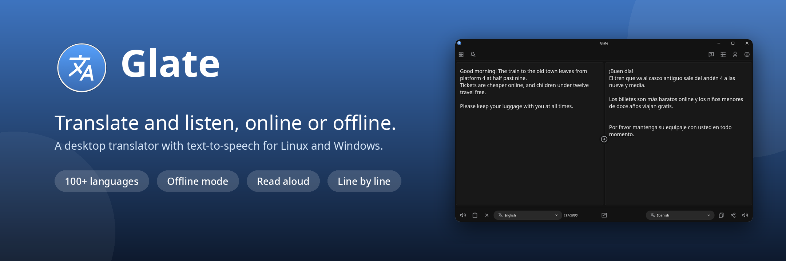
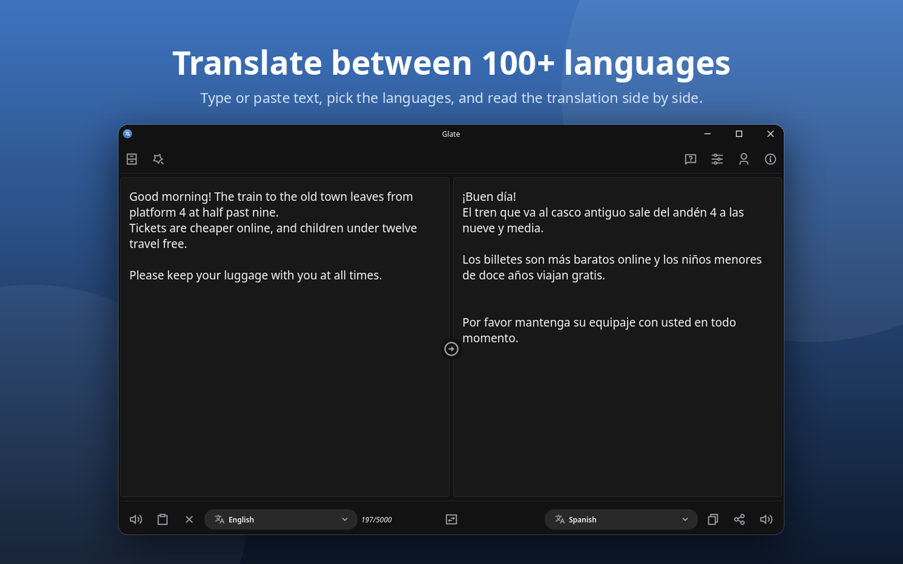
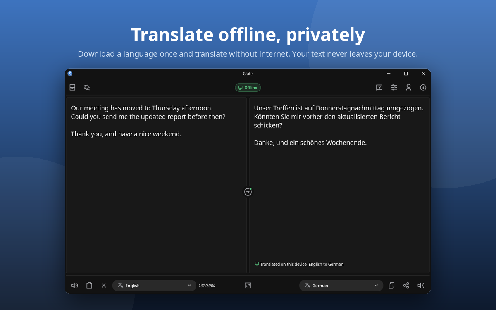
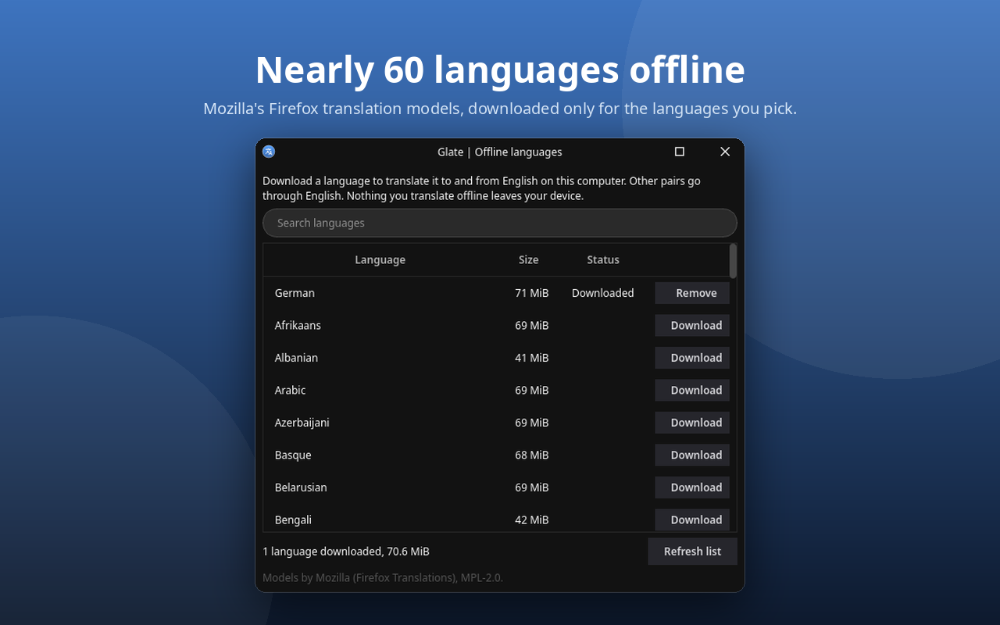
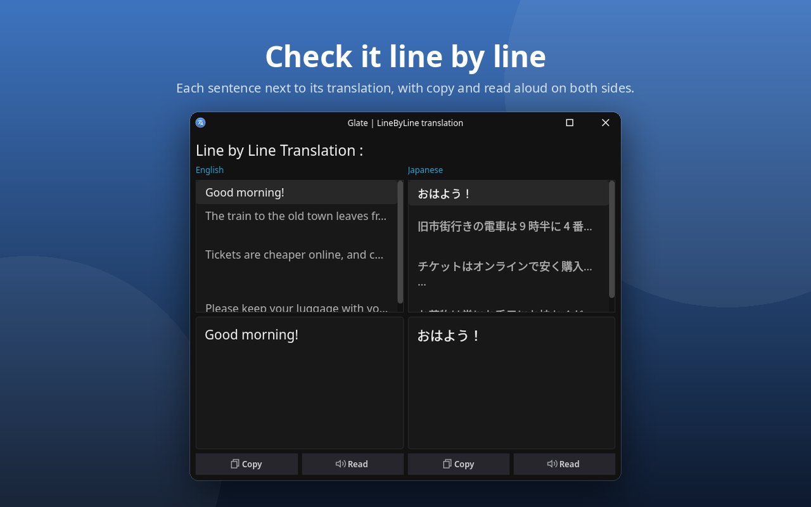
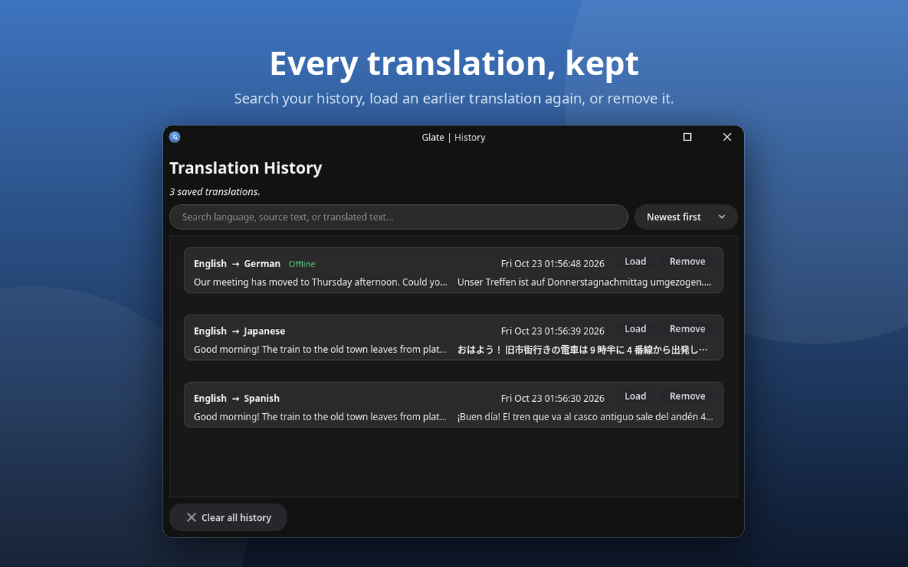
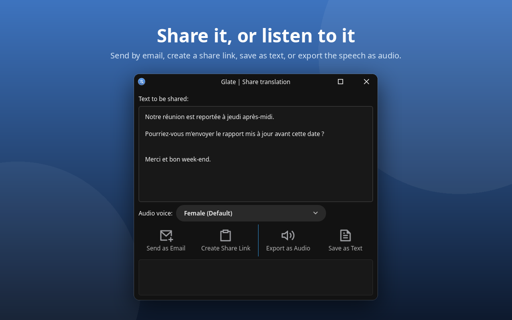
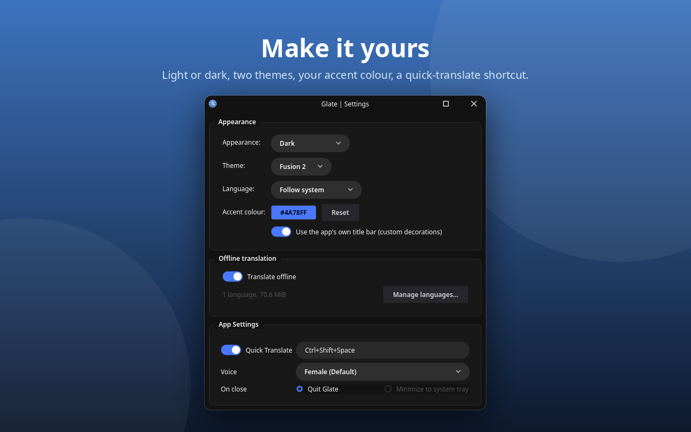

# Glate - Translator and Text-to-Speech for Desktop



Glate is a fast desktop translator with built-in text-to-speech, history, and sharing tools.
It translates online, or offline on your own computer with downloadable language models.

<p>
  <a href="https://flathub.org/apps/com.ktechpit.glate"></a>
  <a href="https://snapcraft.io/glate"></a>
</p>

## Features

- Translate between 100+ languages
- Offline mode: download a language once and translate without internet; your text never
  leaves your device (Pro)
- Line-by-line translation view for structured text
- Text-to-speech playback with voice and gender options
- Export speech to audio formats with advanced controls
- Translation history with search, quick copy, and text export
- Share translations by email, a share link, or a text file
- Global quick-translate hotkey on X11/XWayland
- Light and dark appearance, two themes, your accent colour
- Interface in English, German, French, Brazilian Portuguese and Italian

## Screenshots









An older video tour of Glate is on [YouTube](https://www.youtube.com/watch?v=FxTDqcIgk7g).

## Install

### Flathub

```bash
flatpak install flathub com.ktechpit.glate
```

### Snap Store

```bash
sudo snap install glate
```

Every change on `main` is published to the `edge` channel and every release to `stable`;
`sudo snap install glate --edge` tries the newest build.

### Windows

A portable build (`Glate-Portable-<version>-Win64.zip`) is attached to every
[release](https://github.com/keshavbhatt/glate-ng/releases).

## Offline translation

With offline mode on (Settings, "Translate offline"), Glate translates on your computer with
Mozilla's Firefox translation models and its translation engine, so nothing you translate leaves your
device. No model ships with the app: open "Manage languages..." and download the languages you
need. Each language covers both directions to and from English: 40 to 100 MB, most about 70 MB.
Pairs without English, such as German to French, go through English.

- Nearly 60 languages are available offline; the online service covers 100+.
- Choose the source language yourself: detecting it needs the online service.
- Models come from this repository's
  [`models` release](https://github.com/keshavbhatt/glate-ng/releases/tag/models), mirrored
  unchanged from Mozilla, and every file is checked against its SHA-256 before it is used.
- Offline mode is part of Glate Pro.

## Build from source

Glate needs Qt 6.10 or later (Core, Gui, Widgets, Network, Multimedia, LinguistTools),
CMake 3.25, a C++20 compiler, git, and on Linux X11/xcb and PCRE2 development files. The first
configure fetches Mozilla's translation engine (pinned in `cmake/FetchTranslationsEngine.cmake`)
into `third_party/translations`; it builds with the app.

```bash
cmake -S . -B build-release -DCMAKE_BUILD_TYPE=Release
cmake --build build-release -j
```

Add `-DGLATE_OFFLINE_ENGINE=OFF` to build without the offline engine; offline mode is then hidden.

### Development builds

Day-to-day development builds against the same Qt the snap ships, from the KDE snap SDK
(see `DOCS/DECISIONS.md`, ADR-001). Install the snaps once:

```bash
sudo snap install kde-qt6-core24-sdk kf6-core24
sudo snap install cmake --classic
```

Then:

```bash
make build        # build into build-sdk/ with tests, warnings as errors on new code
make test         # build, then run the test suite
make lint         # clang-format, clang-tidy, shellcheck, reuse
scripts/dev-run.sh
```

The offline translation tests use real models; install them once with
`python3 tools/models/models.py install third_party/test-models en-de de-en`.
`make screenshots` remakes the images in `screenshots/`.

## Packaging

### Snap

```bash
snapcraft
```

The snap version is derived from the CMake project version during the build. Releases are
tag based: see `.github/RELEASE.md`.

### Flatpak

The Flathub package ([flathub/com.ktechpit.glate](https://github.com/flathub/com.ktechpit.glate))
builds from a release tag of this repository, with Mozilla's engine as pinned source archives
(`tools/flathub/engine_sources.py` prints them). For a local Flatpak built from this source tree:

```bash
./build-flatpak.sh
```

This creates a versioned bundle like `glate-4.4.1.flatpak`.

### Windows

```bash
cmake -S . -B build-release -G Ninja -DCMAKE_BUILD_TYPE=Release
cmake --build build-release -j
cpack --config build-release/src/CPackConfig.cmake
```

Windows packaging output is generated through NSIS/ZIP via CPack. Tagged releases are built by
`.github/workflows/release.yml` (see `.github/RELEASE.md`).

## Global hotkey on Wayland

Global hotkeys are not available on native Wayland sessions due to compositor security restrictions.
If you need system-wide quick-translate hotkeys, run Glate on an X11 session (or via XWayland where supported).

## Contributing

Contributions are welcome under the GPL-3.0-or-later. Run `make test` and `make lint` before
sending a change. New code follows `.clang-format` and `.clang-tidy`; decisions are recorded in
`DOCS/DECISIONS.md` and third-party components in `THIRD_PARTY.md`.

## Credits

[Alan Pope](https://github.com/popey) of [Canonical](https://github.com/canonical) helped decide the app name.
Offline translation uses Mozilla's [translation engine and models](https://github.com/mozilla/translations)
(MPL-2.0).

## Licence

Glate is free software under the GPL-3.0-or-later. The account and licence code is
source-available under the Ktechpit Licensing Module License. See [LICENSING.md](LICENSING.md)
for which files are covered by which licence. Glate 4.3.0 and earlier were released under MIT.
